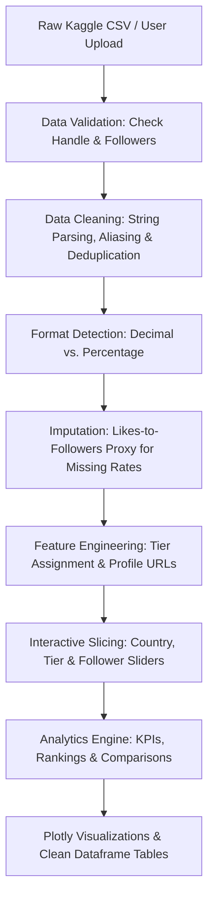

# InfluencerIQ — Instagram Influencer Analytics System

An enterprise-grade, empirical Python and Streamlit analytics system for evaluating Instagram influencer performance, audience scale, engagement depth, and ranking dynamics using genuine public Kaggle benchmark data.

---

## 📋 Table of Contents
- [Project Overview](#-project-overview)
- [Key Features & Dashboard Pages](#-key-features--dashboard-pages)
  - [Page 1: Overview Dashboard](#page-1-overview-dashboard)
  - [Page 2: Influencer Explorer](#page-2-influencer-explorer)
  - [Page 3: Rankings & Leaderboard](#page-3-rankings--leaderboard)
  - [Page 4: Influencer Comparison](#page-4-influencer-comparison)
  - [Page 5: How It Works (Methodology)](#page-5-how-it-works-methodology)
  - [Page 6: Data Management & Export](#page-6-data-management--export)
- [Data Processing Pipeline & Architecture](#-data-processing-pipeline--architecture)
- [Dataset Provenance & Schema](#-dataset-provenance--schema)
  - [Kaggle Dataset Metadata](#kaggle-dataset-metadata)
  - [Supported Data Fields](#supported-data-fields)
  - [Automated Column Aliasing](#automated-column-aliasing)
- [Mathematical Formulas & Methodology](#-mathematical-formulas--methodology)
  - [Engagement Rate Formulation](#1-engagement-rate-formulation)
  - [Decimal vs. Percentage Detection](#2-decimal-vs-percentage-detection)
  - [Follower Tier Thresholds](#3-follower-tier-thresholds)
  - [Multi-Metric Normalization (Radar & Scores)](#4-multi-metric-normalization-radar--scores)
- [Project Directory Structure](#-project-directory-structure)
- [Installation & Local Setup (Windows)](#-installation--local-setup-windows)
- [Automated Testing & Quality Verification](#-automated-testing--quality-verification)
- [Troubleshooting & FAQs](#-troubleshooting--faqs)
- [Known Limitations & Ethical Guidelines](#-known-limitations--ethical-guidelines)

---

## 🌟 Project Overview

**InfluencerIQ** addresses the common pitfalls of influencer marketing where decisions are made purely on raw follower counts. By analyzing public benchmark datasets from Kaggle, the platform demonstrates that **audience scale does not equal audience engagement**. It empowers students, researchers, and marketing analysts to:
- Benchmark top global accounts against category and tier averages.
- Contrast reported 60-day engagement rates against likes-to-followers proxies.
- Evaluate creators on normalized multi-dimensional radar charts.
- Audit data provenance with complete transparency (genuine Kaggle snapshot vs. synthetic fallback demo).

---

## 🖥️ Key Features & Dashboard Pages

### Page 1: Overview Dashboard
- **Executive KPI Cards:**
  - Active profile count.
  - Cumulative audience reach (total followers represented).
  - Average and median followers per influencer.
  - Overall average engagement rate.
  - Average likes per post across creators.
  - Dynamic highlight card for the #1 creator under the selected metric.
- **Interactive Visualizations (Plotly):**
  - **Top 10 by Followers:** Horizontal bar chart with country color coding.
  - **Top 10 by Engagement Rate (%):** Highlights creators generating the highest interaction per follower.
  - **Scale vs. Engagement Scatter Plot:** Log-scale distribution of audience size vs. interaction percentage with dataset benchmark reference lines.
  - **Follower Tier Distribution:** Donut chart segmenting profiles into Nano, Micro, Mid-tier, Macro, and Mega tiers.
  - **Geographic Origins:** Bar chart of the top creator countries represented.
  - **Engagement Distribution:** Statistical histogram with mean and median indicators.

### Page 2: Influencer Explorer
- **Searchable Creator Directory:** Autocomplete selector for individual Instagram handles.
- **Direct Instagram Link:** Direct button to verify profiles at `https://www.instagram.com/<handle>/`.
- **Granular Metrics Cards:** Followers, engagement rate, average likes, recent average likes, post count, and source influence score.
- **Volume Breakdown Chart:** Log-scaled bar chart displaying follower scale alongside interaction volumes.
- **Benchmark Analysis:** Compares the creator's engagement rate directly against their specific follower tier average and the global dataset average.
- **No Fabricated Data:** Clearly notes that single-snapshot records contain no artificial historical growth curves.

### Page 3: Rankings & Leaderboard
- **Multi-Metric Sorting:** Sort by Followers, Engagement Rate, Average Likes, Recent Average Likes, or Source Influence Score.
- **Dual-Ranking System:**
  - **Calculated App Rank (`#1, #2...`):** Dynamically computed based on current filters and sort order.
  - **Original Source Rank:** Preserved from the source Kaggle dataset for auditing.
- **Comprehensive Slicing:** Multi-select filtering by country, follower tier, and follower count range.
- **Exportable Data:** Download the active ranked leaderboard as a CSV with a single click.
- **Missing Value Resilience:** Missing values (`NaN`) are safely placed last (`na_position="last"`) without crashing.

### Page 4: Influencer Comparison
- **Multi-Profile Comparison:** Select between **2 and 5 creator handles** for side-by-side evaluation.
- **Dynamic Leader Badges:** Automatically identifies and highlights the winning creator for each metric.
- **Comparative Metrics Table:** Side-by-side matrix showing exact counts, percentages, and leaders.
- **Isolated-Scale Comparison Charts:** Individual metric bar charts ensuring unlike units are never mixed.
- **Normalized Relative Radar Chart (0–100 Scale):** Normalizes followers, engagement, and likes on a relative index to prevent misleading shared axes.
- **Scale vs. Engagement Divergence:** Automatically detects and explains trade-offs (e.g., when a creator has 10x more followers but a smaller creator has 3x higher engagement).

### Page 5: How It Works (Methodology)
A dedicated, beginner-friendly educational module explaining the analytics process in detail:
- **Section A: Data Source & Origin:** Explains dataset origin, loaded column types, and why snapshots differ from live API feeds.
- **Section B: Data Processing Workflow:** Illustrates the end-to-end 7-step pipeline with an embedded Mermaid workflow diagram.
- **Section C: Engagement Rate Formulas:** Documents the source 60-day metric, likes-to-followers proxy formula, and decimal-to-percentage conversion.
- **Section D: Creator Follower Tiers:** Documents exact thresholds used for Nano, Micro, Mid-tier, Macro, and Mega categories.
- **Section E: Ranking Engine & Logic:** Explains sorting rules, tie-breaking mechanisms, and contrasts app rank with source rank.
- **Section F: Interactive Dynamic Comparison Demo:** An interactive widget where users pick two creators and inspect live metric comparisons and leader resolutions.
- **Section G: Composite Influencer Score:** Documents an optional multi-criteria index ($0.35 \times \text{Followers} + 0.45 \times \text{Engagement} + 0.20 \times \text{Influence Score}$).
- **Section H: Limitations & Data Ethics:** Discusses snapshot staleness, public vs. private data constraints, and bot inflation considerations.

### Page 6: Data Management & Export
- **Schema & Health Diagnostics:** Inspect non-null counts, null percentages, and data types for all loaded columns.
- **Drag-and-Drop CSV Uploader:** Upload custom CSV files with automated column aliasing and validation feedback.
- **Dataset Export:** Download the complete cleaned dataset or the filtered subset.
- **Data Protection Policy:** Guarantees that raw source CSVs in `data/raw/` are protected from unintended overwrites.

---

## 🔄 Data Processing Pipeline & Architecture



---

## 📊 Dataset Provenance & Schema

### Kaggle Dataset Metadata
- **Dataset Title:** [Top Instagram Influencers Data (Cleaned)](https://www.kaggle.com/datasets/surajjha051/top-instagram-influencers-data-cleaned)
- **Author:** Suraj Jha ([Kaggle Profile: @surajjha051](https://www.kaggle.com/surajjha051))
- **Source URL:** `https://www.kaggle.com/datasets/surajjha051/top-instagram-influencers-data-cleaned`
- **Verified GitHub Mirror:** `https://raw.githubusercontent.com/AleenaHanjgikar/instagram-influencer-analytics/main/top_insta_influencers_Cleaned_Data.csv`
- **License:** CC0: Public Domain (No Rights Reserved)
- **Collection Date:** August 2022
- **Scope:** Top 200 global Instagram accounts (e.g., Cristiano Ronaldo, Kylie Jenner, Leo Messi, Selena Gomez, The Rock, Ariana Grande).

### Supported Data Fields

| Field Name | Type | Description |
| :--- | :--- | :--- |
| `handle` | string | Instagram handle (cleaned, `@` removed) |
| `followers` | int64 | Total followers count (supports `M`, `k`, commas) |
| `engagement_rate` | float64 | Engagement rate percentage (e.g. `1.39%`) |
| `engagement_metric_type` | string | Origin tag (`Source Reported` vs. `Calculated Proxy`) |
| `avg_likes` | float64 | Historical average likes per post |
| `new_post_avg_like` | float64 | Average likes on recent posts |
| `total_likes` | float64 | Cumulative likes across account history |
| `posts` | float64 | Total posts published |
| `influence_score` | float64 | Evaluated creator influence index (0–100) |
| `country` | string | Creator geographic origin / primary market |
| `tier` | string | Follower tier (`Nano`, `Micro`, `Mid-tier`, `Macro`, `Mega`) |
| `source_rank` | float64 | Original standing rank from Kaggle dataset |
| `app_rank` | int64 | Dynamically calculated rank under current view |
| `profile_url` | string | Web link to live Instagram profile |
| `data_provenance` | string | Explicit origin tag (`Genuine Kaggle Dataset` vs. `Synthetic Demo`) |

### Automated Column Aliasing
When loading custom or third-party CSVs, `src/data_cleaning.py` automatically maps common schema variations:
- **Username / Handle:** `channel_info`, `username`, `account_username`, `influencer_name`, `profile_name`, `influencer` $\rightarrow$ `handle`
- **Followers:** `follower_count`, `followers_count`, `total_followers`, `follower` $\rightarrow$ `followers`
- **Average Likes:** `avg_likes_per_post`, `average_likes`, `likes_avg`, `mean_likes` $\rightarrow$ `avg_likes`
- **Engagement Rate:** `60_day_eng_rate`, `60dayeng_rate`, `sixty_day_eng_rate`, `eng_rate`, `engagement` $\rightarrow$ `engagement_rate_raw`
- **Recent Likes:** `recent_avg_likes`, `recent_likes`, `new_post_avg_likes` $\rightarrow$ `new_post_avg_like`
- **Posts:** `posts_total`, `total_posts`, `post_count` $\rightarrow$ `posts`
- **Country:** `country_name`, `region`, `location` $\rightarrow$ `country`

---

## 📐 Mathematical Formulas & Methodology

### 1. Engagement Rate Formulation
- **Source 60-Day Engagement Rate:**
  $$\text{Engagement Rate (\%)} = \text{Decimal Fraction} \times 100 \quad (\text{if fraction format})$$
- **Likes-to-Followers Engagement Proxy:**
  Calculated when engagement rate is missing (e.g., row 168 `rkive` in the Kaggle dataset) or when user uploads only contain likes and follower counts:
  $$\text{Proxy Rate (\%)} = \left( \frac{\text{Average Likes}}{\text{Followers}} \right) \times 100$$
  *(Clearly documented in the UI as a proxy rather than complete interaction rate).*
- **Standard Complete Formula (when comments are present):**
  $$\text{Engagement Rate (\%)} = \left( \frac{\text{Average Likes} + \text{Average Comments}}{\text{Followers}} \right) \times 100$$

### 2. Decimal vs. Percentage Detection
- Social media datasets frequently mix decimal notation (`0.0139`) with percentage notation (`1.39`).
- The system checks the 75th percentile of the engagement distribution:
  - If $\text{P}_{75} \le 0.20$ (20%), values are recognized as fractional decimals and multiplied by 100 once.
  - If values are already $\ge 1.0$, they are preserved as percentages, preventing double-multiplication errors.

### 3. Follower Tier Thresholds
Creators are categorized based on industry-standard audience scale brackets:
- **Nano:** $< 10,000$ followers
- **Micro:** $10,000 - 100,000$ followers
- **Mid-tier:** $100,000 - 500,000$ followers
- **Macro:** $500,000 - 1,000,000$ followers
- **Mega:** $\ge 1,000,000$ followers

### 4. Multi-Metric Normalization (Radar & Scores)
Comparing followers (hundreds of millions) and engagement rate (single digits) on a shared axis causes extreme visual distortion. The platform uses Min-Max normalization to rescale each metric to a relative 0–100 scale:
$$\text{Norm}(X) = \frac{X - X_{\min}}{X_{\max} - X_{\min}} \times 100$$

---

## 📁 Project Directory Structure

```
Instagram-Influencer-Analytics/
├── app.py                           # Main Streamlit multi-page web application
├── requirements.txt                 # Application runtime dependencies
├── README.md                        # Complete system documentation
├── data/
│   ├── raw/
│   │   ├── top_insta_influencers_data.csv   # Original Kaggle dataset (200 records)
│   │   └── KAGGLE_SOURCE_INFO.md            # Dataset provenance and download guide
│   ├── processed/
│   │   └── influencers_cleaned.csv          # Cleaned, validated, and normalized dataset
│   ├── synthetic/
│   │   └── sample_synthetic_influencers.csv # Explicitly labeled demonstration fallback
│   ├── campaigns.csv                # Preserved campaign returns data for legacy analytics
│   ├── follower_history.csv         # Preserved historical trajectory data
│   └── influencers.csv              # Preserved legacy sample records
├── src/
│   ├── __init__.py
│   ├── data_loader.py               # Dataset loading, caching, and fallback management
│   ├── data_cleaning.py             # Schema normalization, string parsing, tier classification
│   ├── analytics.py                 # KPIs, filtering, rankings, and comparison algorithms
│   ├── visualization.py             # Interactive Plotly figures with isolated scaling
│   └── data_generator.py            # Preserved synthetic generator utility
└── tests/
    ├── __init__.py
    ├── test_data_cleaning.py        # Automated unit tests for data cleaning & parsing
    └── test_analytics.py            # Automated unit tests for analytics & rankings
```

---

## 🚀 Installation & Local Setup (Windows)

### Prerequisites
- Python 3.10 or higher.
- Windows PowerShell or Command Prompt.

### Step 1: Open PowerShell in Project Directory
```powershell
B:
cd \MfdaPR\Instagram-Influencer-Analytics
```

### Step 2: Set Up Virtual Environment (Recommended)
```powershell
python -m venv .venv
.\.venv\Scripts\Activate.ps1
```
*(If script execution is restricted on your machine, run `Set-ExecutionPolicy -Scope Process -ExecutionPolicy Bypass` or directly call `.\.venv\Scripts\python.exe`)*

### Step 3: Install Required Dependencies
```powershell
python -m pip install --upgrade pip
pip install -r requirements.txt
```

### Step 4: Run Automated Tests
Verify data parsing, mathematical formulas, and ranking logic:
```powershell
python -m unittest discover -s tests -v
```

### Step 5: Launch the Application
```powershell
python -m streamlit run app.py
```
Streamlit will automatically open the dashboard in your default browser at `http://localhost:8501`.

---

## 🧪 Automated Testing & Quality Verification

InfluencerIQ comes with an automated unit test suite built using Python's standard `unittest` framework:

```powershell
python -m unittest discover -s tests -v
```

### Test Suite Coverage:
- **`tests/test_data_cleaning.py`**:
  - `test_parse_numeric_strings`: Validates parsing of `475.8M`, `65.4k`, `2.5B`, `1.39%`, and comma-separated numbers.
  - `test_detect_engagement_rate_format`: Verifies decimal fraction vs. percentage detection.
  - `test_no_double_conversion_of_percentages`: Asserts that existing percentage rates are not multiplied twice.
  - `test_likes_to_followers_proxy_fallback`: Verifies proxy calculation when engagement rates are missing.
  - `test_assign_follower_tier`: Verifies threshold assignments for Nano through Mega tiers.
  - `test_clean_dataset_with_aliases`: Tests column header normalization and alias resolution.
  - `test_missing_required_columns_error`: Verifies informative `ValueError` on invalid schemas.
  - `test_empty_dataframe_error`: Ensures empty inputs are handled cleanly without crashing.
- **`tests/test_analytics.py`**:
  - `test_calculate_kpis`: Tests summary metric calculations and empty dataset handling.
  - `test_filter_and_rank_followers`: Verifies descending audience volume ranking.
  - `test_filter_and_rank_engagement`: Verifies engagement ranking where smaller creators lead.
  - `test_filter_by_country_and_tier`: Tests combined multi-criteria slicing.
  - `test_compare_influencers_leaders`: Verifies leader detection across multiple creators.
  - `test_compare_influencers_validation`: Asserts requirement for at least 2 profiles.
  - `test_composite_score_bounds`: Verifies Min-Max score bounds ($0 \le \text{Score} \le 100$).

---

## 🛠️ Troubleshooting & FAQs

| Scenario / Error | Cause | Resolution |
| :--- | :--- | :--- |
| `FileNotFoundError: top_insta_influencers_data.csv` | Local raw Kaggle file was moved or deleted | Select **"Genuine Kaggle Dataset (Online Mirror)"** in the sidebar, or re-download the CSV into `data/raw/`. |
| Script execution policy blocks `.venv` activation | Windows PowerShell security policy | Execute `Set-ExecutionPolicy -Scope Process -ExecutionPolicy Bypass` in the current session. |
| Port `8501` is already in use | Another background Streamlit process is running | Run on another port: `python -m streamlit run app.py --server.port 8502`. |
| Custom CSV upload shows error | Missing required fields | Ensure your file has at least a handle/username column and a follower count column. |

---

## ⚠️ Known Limitations & Ethical Guidelines

1. **Snapshot Nature:** Public Kaggle datasets reflect a static snapshot in time (August 2022). Metrics such as follower count and average likes naturally fluctuate in real-world environments.
2. **Public vs. Private Signals:** Public datasets lack access to private Instagram Insights (Reach, Impressions, Story Saves, Link Clicks, Conversion ROI). These require authenticated Meta Graph API permissions.
3. **Audience Quality & Bot Inflation:** High follower numbers may include inactive or bot accounts. Engagement rate acts as a partial quality check, but cannot detect sophisticated fraud without follower-level auditing.
4. **ROI Uncertainty:** A high engagement rate indicates strong audience resonance, but does not guarantee direct commercial sales conversions.
